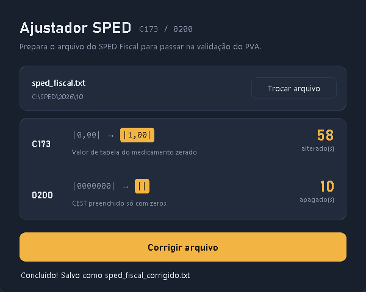

# Ajustador SPED (C173 / 0200)

Prepara o arquivo do SPED Fiscal para passar na validação do PVA, corrigindo dois registros que costumam travar a importação.



## O que ele corrige

| Registro | Campo | Antes | Depois |
|---|---|---|---|
| C173 | VL_TAB_MED (valor de tabela do medicamento) | `\|0,00\|` | `\|1,00\|` |
| 0200 | CEST preenchido só com zeros | `\|0000000\|` | `\|\|` |

O resto do arquivo é copiado sem alteração. Nenhuma linha é criada ou apagada, então os totalizadores (C990, 9900, 9999) continuam válidos.

O original não é modificado: o resultado é salvo na mesma pasta como `<nome>_corrigido.txt`.

## Como usar

1. Baixe o `ajustador_sped_c173_0200.exe` na página de [Releases](../../releases).
2. Abra o programa e clique em **Escolher arquivo** para selecionar o `.txt` do SPED.
3. Clique em **Corrigir arquivo**. A tela mostra quantos valores foram alterados em cada registro.
4. Importe o `_corrigido.txt` no PVA.

## Rodar pelo código

Requer Python 3.12 no Windows.

```
pip install -r requirements.txt
python ajustador_sped_c173_0200.py
```

## Gerar o executável

```
pyinstaller --noconfirm ajustador_sped_c173_0200.spec
```

O `.exe` é gerado em `dist/`.

## Licença

[MIT](LICENSE)
